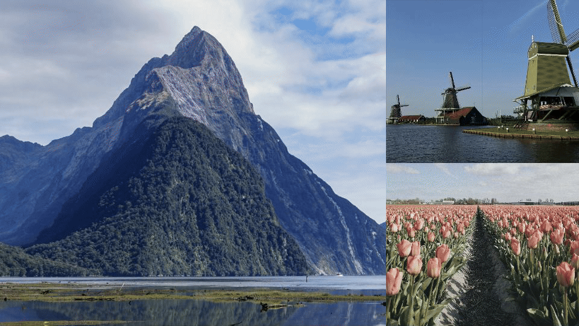

<p align="center">
  
</p>

# Minimal Photo Slideshow

I wanted a minimal slideshow with modern animations like Apple’s screensavers, with grids and moving photo layouts. So I brought those animations to your Home Assistant dashboard.



Six animation styles, an optional clock and date, and a visual editor for your Home Assistant dashboard. This card requires its sister integration also to be installed to connect photo sources such as Apple photos, google photos and many more.


## Animation styles

| Style | Animation |
| --- | --- |
| **Origami** | Photos fold into changing grids and full-screen layouts. |
| **Sliding Panels** | Sliding reveals introduce photos within a mosaic. |
| **Shifting Tiles** | Tiles split, merge, shift and bounce as the layout evolves. |
| **Floating** | Large photographs float across the screen. |
| **Ken Burns** | Gentle zooms and pans with soft dissolves. |
| **Standard Fade** | A simple crossfade between photographs. |

Choose the timing, place the clock in any corner, select its font, and show the date underneath. Photo layouts adapt to landscape and portrait screens.

## Install with HACS

1. In **HACS → Custom repositories**, add `https://github.com/lukevink/minimal-slideshow` with type **Dashboard**.
2. Download **Minimal Photo Slideshow** and reload your browser.
3. Edit a dashboard, choose **Add card**, and select **Minimal Photo Slideshow**.
4. Choose an animation and photo source in the visual editor.

For iCloud, Google Photos, Immich, PhotoPrism, Synology, UGREEN, Nextcloud, Ente, local folders or Home Assistant Media Source, install the [Minimal Slideshow integration](https://github.com/lukevink/minimal-slideshow-integration). Its configured sources appear in the card editor. You can also supply image URLs directly.

If the resource was not added automatically, open **Settings → Dashboards → Resources** and add `/hacsfiles/minimal-slideshow/minimal-slideshow.js` as a **JavaScript module**.

**Manual installation:** copy `dist/minimal-slideshow.js` to `/config/www/` and add `/local/minimal-slideshow.js` as a JavaScript module. When upgrading an older manual installation, replace its existing resource entry.

## Full-screen view

Create a **Panel (single card)** view, then add and configure the card visually. YAML example:

```yaml
title: Photos
path: photos
type: panel
cards:
  - type: custom:minimal-photo-slideshow
    source: minimal_slideshow
    effect: origami
    interval: 8
    duration: 1800
    clock: true
    clock_position: bottom-left
    clock_font: system
    clock_size: 112
    show_date: true
    time_format: auto
```

Select your album in the visual editor. Set **Card height** to suit your dashboard:

- `100%` fills the parent container when that container has a defined height. To fill the remaining space in a column, the dashboard layout must allocate that space to the card.
- `100dvh` fills the screen height, ideal for a Panel view on a tablet with its dashboard header hidden.
- `500px` gives the card a fixed height within a dashboard.
- Leave it blank to use the screen height minus the dashboard header.

For a container that already defines the available height:

```yaml
height: 100%
```

## Options

| Option | Default | Meaning |
| --- | --- | --- |
| `source` | `minimal_slideshow` | Integration photo source. |
| `album_id` | Choose a source | Select a configured integration source in the editor. |
| `images` | None | List of image URLs; overrides the integration source. |
| `effect` | `origami` | `origami`, `sliding_panels`, `shifting_tiles`, `floating`, `ken_burns`, `fade`. |
| `interval` | `8` | Hold time/movement pace in seconds, 2–120. Transitions add their own duration. |
| `duration` | `1800` | Transition duration in milliseconds, 250–6000. |
| `height` | Viewport less header | Any CSS height, e.g. `100%` (sized parent), `100dvh` (full screen), or `500px`. |
| `clock` | `false` | Show a clock. |
| `clock_position` | `bottom-left` | `top-left`, `top-right`, `bottom-left`, `bottom-right`.  |
| `clock_font` | `system` | `system`, `sans`, `rounded`, `serif`, `mono`, `custom`. |
| `custom_font` | System font | Installed CSS font family when `clock_font: custom`. |
| `clock_size` | `112` | Maximum font size in pixels, 40–240; scales down on narrow screens. |
| `time_format` | `auto` | `auto`, `"12"`, or `"24"`. Uses the Home Assistant language/time zone. |
| `show_date` | `false` | Small date below the clock. |
| `tap_action` | `action: none` | Standard Home Assistant tap action. |
| `hold_action` | `action: none` | Standard Home Assistant hold action. |
| `double_tap_action` | `action: none` | Standard Home Assistant double-tap action. |
| `entity` | None | Optional entity for Toggle or More info actions. |

Local images example:

```yaml
type: custom:minimal-photo-slideshow
effect: fade
height: 500px
images:
  - /local/photos/landscape.jpg
  - /local/photos/portrait.jpg
```

External image hosts must allow cross-origin requests (CORS). For private photo libraries, use the integration and select your source in the visual editor.

## Tap, hold and double-tap

Open **Interactions** in the visual editor to choose standard Home Assistant actions: Navigate, Open URL, Perform action, More info, Toggle, Assist or None. Set the optional **Entity** for Toggle or More info. Action targets and confirmation prompts use Home Assistant’s standard configuration.

```yaml
tap_action:
  action: navigate
  navigation_path: /lovelace/home
hold_action:
  action: more-info
  entity: sensor.family_photos_photos
double_tap_action:
  action: perform-action
  perform_action: button.press
  target:
    entity_id: button.family_photos_next_image
```

Use your own dashboard path and entity IDs. See [Home Assistant dashboard actions](https://www.home-assistant.io/dashboards/actions/) for all action options. Existing `home_path` settings are converted to Navigate actions when edited.

## Photo buffering

Upcoming photos load in the background while the current layout stays visible. A temporary buffer in the browser tab lets the slideshow resume quickly after navigating away and back. It holds up to two recent sources, with a combined limit of 48 MB, and expires after ten minutes. A full browser refresh starts a fresh buffer.

## Automation controls

The [integration](https://github.com/lukevink/minimal-slideshow-integration#automation-controls) creates **Next Image**, **Previous Image**, and **Restart** buttons for each photo source. Use **Button: Press** in a Home Assistant automation to control its open slideshows.

## License

[MIT](LICENSE). [Preview photo credits](docs/PHOTO_CREDITS.md).

## Inspiration

Inspired by Apple’s photo screensavers and [Eyal Gal’s Album Slideshow](https://github.com/eyalgal/album_slideshow).
